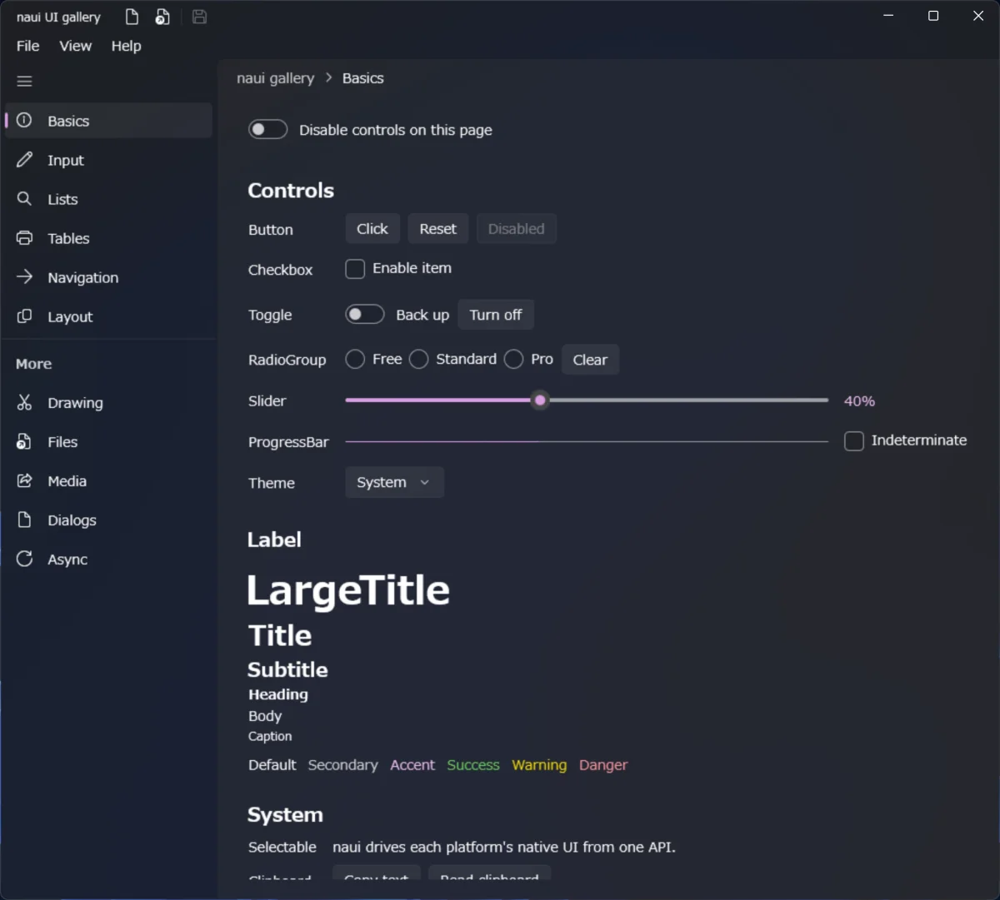
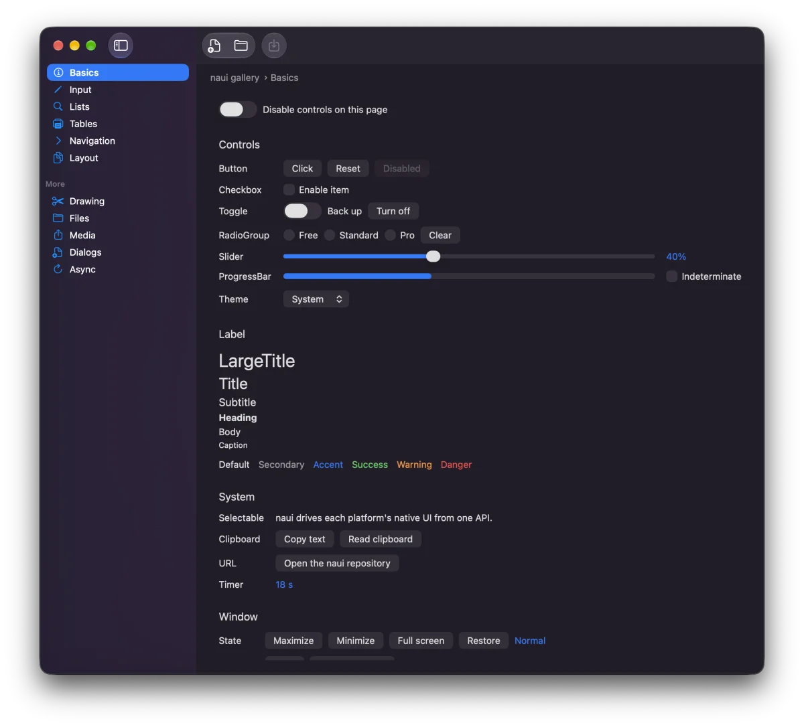
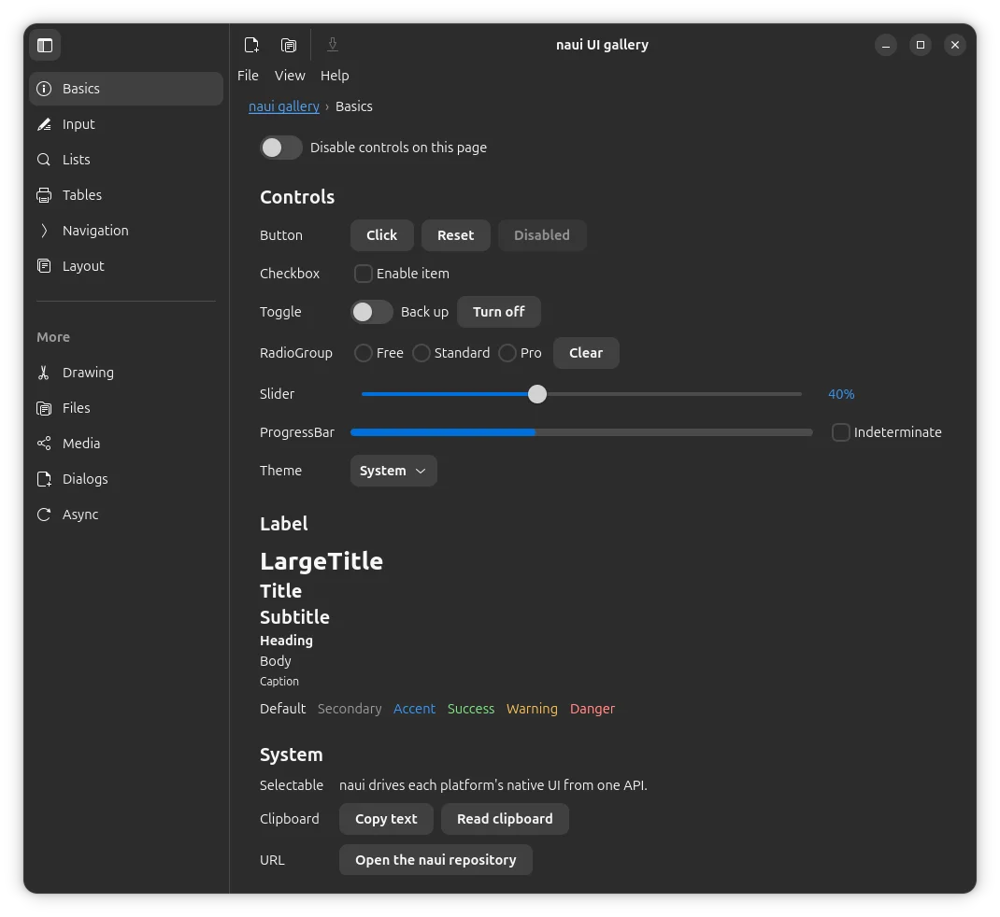
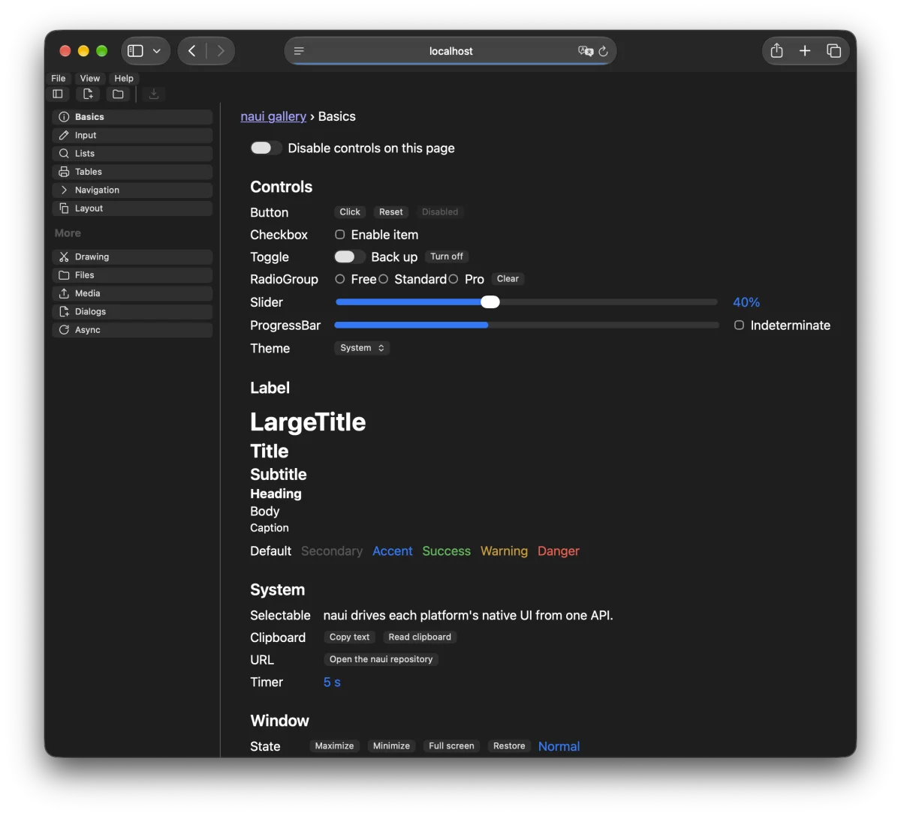

# naui

[](https://crates.io/crates/naui)
[](https://docs.rs/naui)
[](#ライセンス)
[](https://github.com/mokuichi147/naui/actions/workflows/ci.yml)

各 OS のネイティブ UI を、1 つの Rust API から扱う軽量 GUI ツールキットです。

naui はウィジェットを自前で描画しません。ボタン、入力欄、レイアウト、IME、
アクセシビリティ、テーマへの追従は、それぞれのプラットフォームが提供する
ツールキットへ任せます。

| 対象 | バックエンド | ボタンの実体 |
| --- | --- | --- |
| Windows | WinUI 3 (Windows App SDK) | `Microsoft.UI.Xaml.Controls.Button` |
| macOS | AppKit | `NSButton` |
| Linux | GTK4 / libadwaita | `GtkButton` |
| Web (wasm) | DOM | `<button>` |

同じ Gallery のコードを各環境で動かした画面です。見た目はそれぞれの OS の標準に従います。

| Windows 11 Pro 25H2 (Windows App SDK 2.5.1) | macOS Tahoe 26.6.2 |
| --- | --- |
|  |  |
| **Ubuntu 24.04.5 LTS** | **Safari 26.6.2** |
|  |  |

## 特長

- 4 つのバックエンドを同じ API で利用可能
- OS 標準の描画、入力、アクセシビリティ、テーマを活用
- Rust 側でレイアウト計算やメディアのデコードを行わない軽量な設計
  (プラットフォームを補う必要があるところは[既知の制限](docs/known-limitations.md)に明記しています)
- 共通 API で足りない場合はネイティブオブジェクトへアクセス可能
- 最小サンプルと、種別ごとに全ウィジェットの特徴を確認できる Gallery を同梱

## クイックスタート

```sh
cargo add naui
```

`src/main.rs` に次のコードを書いて `cargo run` すると、OS 標準のボタンを持つ
カウンターが起動します。

```rust
use std::cell::Cell;
use std::rc::Rc;

use naui::{Orientation, Padding, Settings};

fn main() -> naui::Result<()> {
    naui::run(Settings::new("counter"), |ui| {
        let window = ui.window("counter", 320.0, 200.0)?;
        let stack = ui.stack(Orientation::Vertical)?;
        stack.set_spacing(12.0);
        stack.set_padding(Padding::all(24.0));

        let label = ui.label("0")?;
        let button = ui.button("増やす")?;
        let count = Rc::new(Cell::new(0));

        button.on_click({
            let label = label.clone();
            move || {
                count.set(count.get() + 1);
                label.set_text(&count.get().to_string());
            }
        });

        stack.append(&label);
        stack.append(&button);
        window.set_child(&stack);
        window.show();
        Ok(())
    })
}
```

全ウィジェットの使用例は [`examples/gallery`](examples/gallery/src/lib.rs) にあります。

### 必要なもの

- Rust 1.85 以降
- Linux: GTK 4.10 以降と libadwaita 1.5 以降の開発用ライブラリ
- Windows: Windows App SDK 1.3 以降のランタイム (動作確認は 2.x)。
  [同梱する](#windows-app-sdk-ランタイムを同梱する)場合は不要です

Ubuntu 24.04 では次のコマンドで導入できます。

```sh
sudo apt install libgtk-4-dev libadwaita-1-dev build-essential pkg-config
```

### Windows App SDK ランタイムを同梱する

`self-contained` フィーチャーを有効にすると、ランタイムを exe と一緒に配れます。
取得されるパッケージのライセンスや配り方は
[ランタイムの同梱](docs/windows-self-contained.md)を参照してください。

### Gallery を実行

```sh
git clone https://github.com/mokuichi147/naui.git
cd naui
cargo run -p gallery
```

Web (wasm) で動かすには、`Cargo.lock` と同じ版の `wasm-bindgen-cli` (現在は 0.2.127)
を入れてからビルドし、<http://localhost:8080/> を開きます。

```sh
rustup target add wasm32-unknown-unknown
cargo install wasm-bindgen-cli --version 0.2.127
cd examples/gallery/web
./build.sh
python3 -m http.server 8080
```

## ウィジェット

| 分類 | API |
| --- | --- |
| ウィンドウ・レイアウト | `Window`、`Stack`、`Grid`、`Scroll`、`Spacer`、`Expander`、`SplitView`、`Toolbar`、`MenuBar`、`Sidebar` |
| 基本・入力 | `Label`、`Button`、`Checkbox`、`Toggle`、`TextInput`、`TextArea`、`PasswordInput`、`SearchInput`、`NumberInput`、`Slider`、`ProgressBar` |
| データ選択 | `ComboBox`、`EditableComboBox`、`RadioGroup`、`DatePicker`、`TimePicker`、`ColorPicker`、`List`、`Table`、`Tree` |
| ファイル・メディア | `FilePicker`、`FileSaver`、`Image`、`Video`、`Audio` |
| 描画 | `Canvas` |
| オーバーレイ | `PopupMenu`、`Dialog`、`Toast` |
| ナビゲーション | `Tabs`、`Navbar`、`Dock`、`Menu`、`Breadcrumbs`、`Pagination`、`Link` |

各環境で何のコントロールになるかは[ウィジェットの実装](docs/widgets.md)、
環境ごとの注意点は[既知の制限](docs/known-limitations.md)にあります。4 環境とも、
統合テストと Gallery で動作を確かめています ([動作確認](docs/development.md#動作確認))。

## ドキュメント

- [使い方](docs/guide.md): ウィジェットの追加と削除、テーマ、配置とサイズ、機能別の補足、別スレッドと非同期
- [ウィジェットの実装](docs/widgets.md): 環境ごとのコントロールと組み立て方、主なデータ型、ネイティブオブジェクトへのアクセス
- [既知の制限](docs/known-limitations.md): 環境ごとの制限
- [ランタイムの同梱](docs/windows-self-contained.md): Windows App SDK を exe と一緒に配る
- [開発](docs/development.md): 動作確認、クレート構成、テスト、CI、リリース
- [ロードマップ](docs/roadmap.md): まだ無い機能と優先度
- [API リファレンス (docs.rs)](https://docs.rs/naui)

## ライセンス

[MIT](LICENSE-MIT) OR [Apache-2.0](LICENSE-APACHE)
